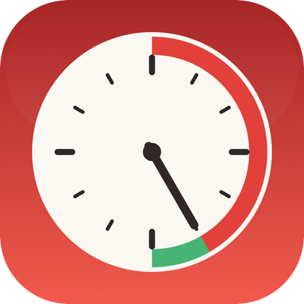
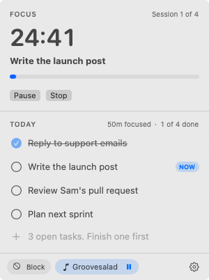
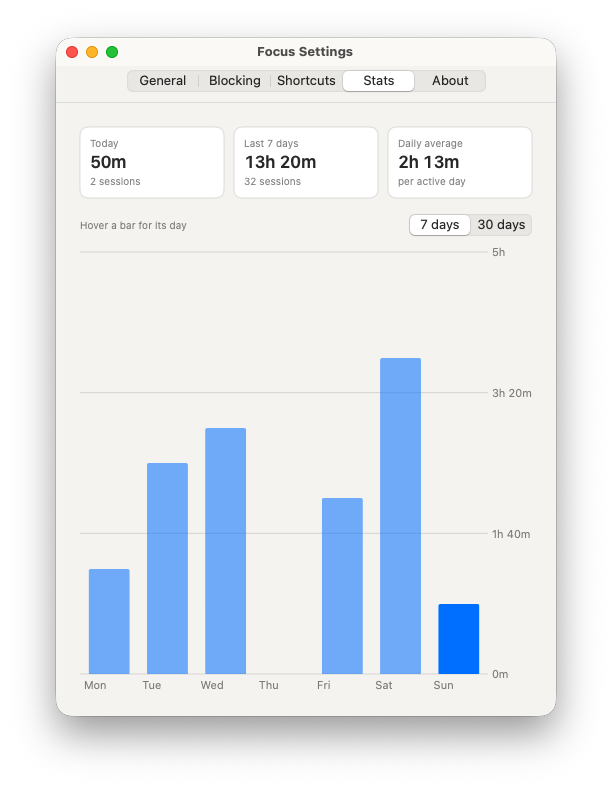
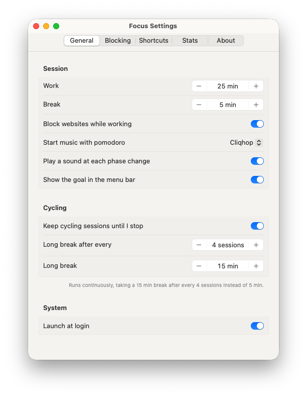

# focus



[](https://github.com/nchourrout/focus/actions/workflows/test.yml)
[](LICENSE)
[](#build--install)

A macOS menu bar app + CLI to get in the zone.

- **Block distracting websites** by editing `/etc/hosts`
- **Play focus music** from seven free, ad-free [SomaFM](https://somafm.com) stations, any HTTP(S) stream, or a local file. Music fades in and out, and ducks under the phase cues
- **Run a pomodoro** as a detached daemon that blocks sites and plays music during work and lifts the block during breaks. It cycles until you stop it, with a long break every 4 sessions, or runs a single session
- **Keep up to 3 tasks for today** and start a pomodoro on one. Tick the running task and a cycling run moves on to the next one after the break
- **See how much you focused** per day, in Settings or with `focus stats`
- **Global hotkeys** and **launch at login**, set in Settings
- One Swift binary is both the menu bar app (no args) and the CLI (a subcommand)

<p align="center">
  
  
  
</p>

## Download

Pre-built `.app` zips are attached to each [GitHub Release](https://github.com/nchourrout/focus/releases). Unzip, drag `Focus.app` to `/Applications`, then:

```bash
xattr -dr com.apple.quarantine /Applications/Focus.app
open /Applications/Focus.app
```

The app is unsigned, so Gatekeeper blocks the first launch until that `xattr` runs (or right-click → Open). The zip doesn't put `focus` on your `$PATH`. Build from source for that.

## Build & install

Requires macOS 13+ and Swift 5.10+. Command Line Tools are enough.

```bash
git clone git@github.com:nchourrout/focus.git ~/dev/focus
cd ~/dev/focus
./Scripts/install.sh   # builds Focus.app, installs it to /Applications,
                       # symlinks /usr/local/bin/focus to the inner binary
open /Applications/Focus.app
```

Two constraints keep Xcode optional. Views use `@ViewState` rather than `@State`, which is a macro on the macOS 27 SDK whose plugin ships only with Xcode. KeyboardShortcuts is pinned to 1.15.0, since later versions use `#Preview` and `@Entry`, which need Xcode's macro plugins too.

## Menu bar

The icon is a stopwatch during work and a coffee cup during breaks, with a live countdown. Idle, it's a dashed circle, slashed when the block is on. **Settings → General → Show the goal in the menu bar** adds the goal next to the countdown, capped at 20 characters.

Clicking it opens a panel:

- **Session**: phase, countdown, goal and progress, with Pause, Stop and Skip break. Idle, it offers to start on the first open task, or to type a goal
- **Today**: tick a task to mark it done, hover for Start and Remove, type in the last row to add one. The running task is tagged NOW. Done tasks drop off at midnight, open ones carry over. Time focused today opens the Stats tab
- **Footer**: Block toggle, music station picker with play/pause, and the gear for Settings (⌘,) and Quit

Settings has General, Blocking (permission, DNS-over-HTTPS, the site list), Shortcuts, Stats and About.

The menu bar runs the same binary in CLI mode for every session action, and starts pomodoros with no flags so both read the same Settings. `~/.focus-pomodoro.json` is the single source of truth, watched for changes with a 5s heartbeat to catch a daemon that died without cleaning up.

## CLI

```bash
focus status                     # block status; --json
sudo focus block                 # block sites from block.txt
sudo focus unblock
sudo focus toggle --json

focus music --list               # built-in stations, least eventful first
focus music groovesalad          # a preset, or any http(s) stream URL
focus music --file ~/brown.mp3 --loop
focus music --stop

focus pomodoro start "write spec"                 # uses your Settings, cycles until stopped
focus pomodoro start "deep work" --work 50 --break 10 --music groovesalad
focus pomodoro start "quiet hour" --no-block
focus pomodoro start --todo 1                     # task 1 as the goal
focus pomodoro status                             # --json
focus pomodoro skip-break
focus pomodoro pause                              # block lifts, music stops
focus pomodoro resume
focus pomodoro stop

focus todo                                        # today's tasks; --json
focus todo add write the spec                     # at most 3 open
focus todo done 1                                 # undo 1 reopens it
focus todo rm 1

focus stats                                       # last 7 days; --days N, --json
```

Every pomodoro flag overrides a Settings value (25/5 out of the box). Cycling and the long break live in **Settings → General** and are re-read at each phase boundary, so a change mid-run applies at the next transition.

Music for a pomodoro comes from `--music`, then the **Start music with pomodoro** preset, then `FOCUS_MUSIC_URI`. Stations are listed least eventful first: `dronezone`, `darkzone`, `deepspaceone` and `synphaera` are ambient with no vocals. `groovesalad` and `cliqhop` have beats, and `missioncontrol` mixes in NASA radio chatter, the worst choice for work involving language.

### Adding a station

AVPlayer will connect to a stream it can't decode and play silence with no error, so a live process proves nothing. Radio Paradise and Ambient Sleeping Pill both fail that way. Check that macOS registers real audio output:

```bash
focus music --uri <url> && sleep 12
pmset -g assertions | grep "$(head -1 ~/.focus-music.pid)"   # a line here means real audio
ps -p "$(head -1 ~/.focus-music.pid)" -o time=                # CPU should climb ~0.15s/10s
```

## Sudoers

`block`, `unblock` and `toggle` write `/etc/hosts`, and the daemon runs them with `sudo -n`. The first Block toggle asks for your admin password once, copies the binary to the root-owned `/Library/PrivilegedHelperTools/com.nchourrout.focus/`, and installs a `NOPASSWD` rule in `/etc/sudoers.d/focus` for that copy only, validated with `visudo -cf`. The rule never names the binary in `/Applications`, which any process running as you could overwrite.

`install.sh` refreshes the copy on upgrade. After a zip upgrade, **Settings → Blocking** shows "needs update" until you click Update.

## State files

- `/etc/hosts`: block entries between `# === FOCUS BLOCK START/END ===` markers, backed up once to `/etc/hosts.backup`
- `~/.focus-pomodoro.json`: the active or paused session
- `~/.focus-music.pid`: playback PID, station and process start time
- `~/Library/Application Support/Focus/`: `block.txt` (your site list), `todos.json`, and `history.jsonl` (one line per work phase, feeding the stats)

## Logs

The daemon and music processes are detached, so diagnostics go to Unified Logging (categories `daemon`, `playback`, `actions`, `launch-at-login`, `terminate`):

```bash
log stream --predicate 'subsystem == "com.nchourrout.focus"'
```

If a session runs but sites stay reachable, `sudo -n block` failed. It's logged under `daemon` with sudo's stderr.

## Testing

Tests use Swift Testing, and CI runs them on every push. With Xcode, `swift test` just works. With Command Line Tools only, link the Testing framework next to the test bundle (SIP strips `DYLD_FRAMEWORK_PATH`) and pass the paths:

```bash
FWK=/Library/Developer/CommandLineTools/Library/Developer/Frameworks
swift build --build-tests
ln -sfn "$FWK/Testing.framework" .build/debug/Testing.framework
ln -sfn /Library/Developer/CommandLineTools/Library/Developer/usr/lib/lib_TestingInterop.dylib .build/debug/lib_TestingInterop.dylib
swift test -Xswiftc -F -Xswiftc "$FWK" -Xlinker -F -Xlinker "$FWK" \
  -Xswiftc -plugin-path -Xswiftc /Library/Developer/CommandLineTools/usr/lib/swift/host/plugins/testing
```

## Releasing

`VERSION` is the single source of truth for the app version.

```bash
./Scripts/release.sh 0.6.0      # bumps VERSION, commits, tags v0.6.0
git push && git push origin v0.6.0
```

The tag push triggers `release.yml`, which builds `Focus.app` on macos-15 and attaches the zip to a new GitHub Release.

## License

MIT, see [LICENSE](LICENSE).
